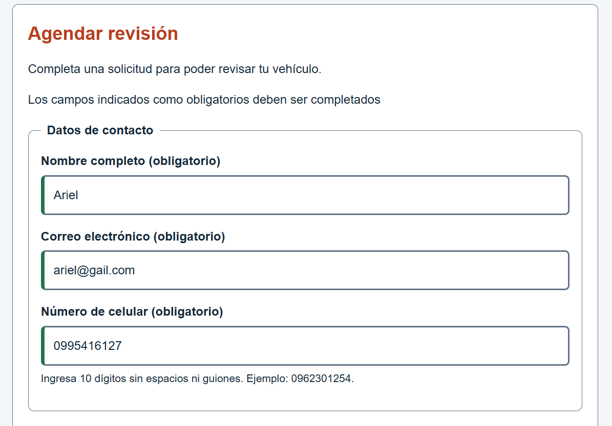
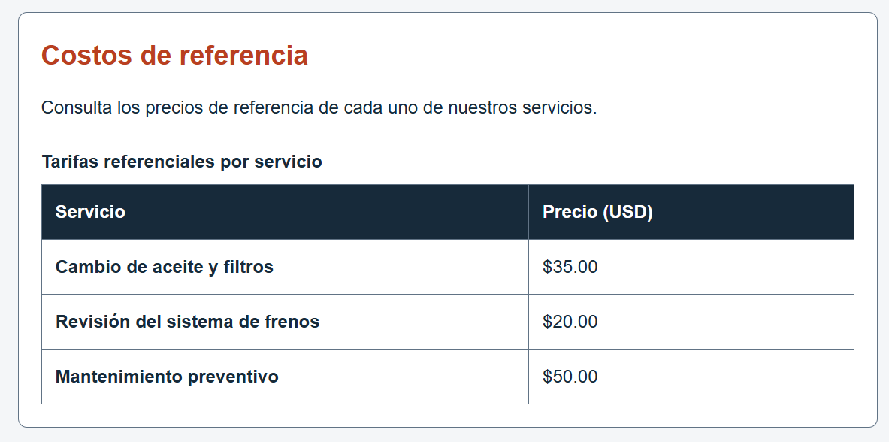
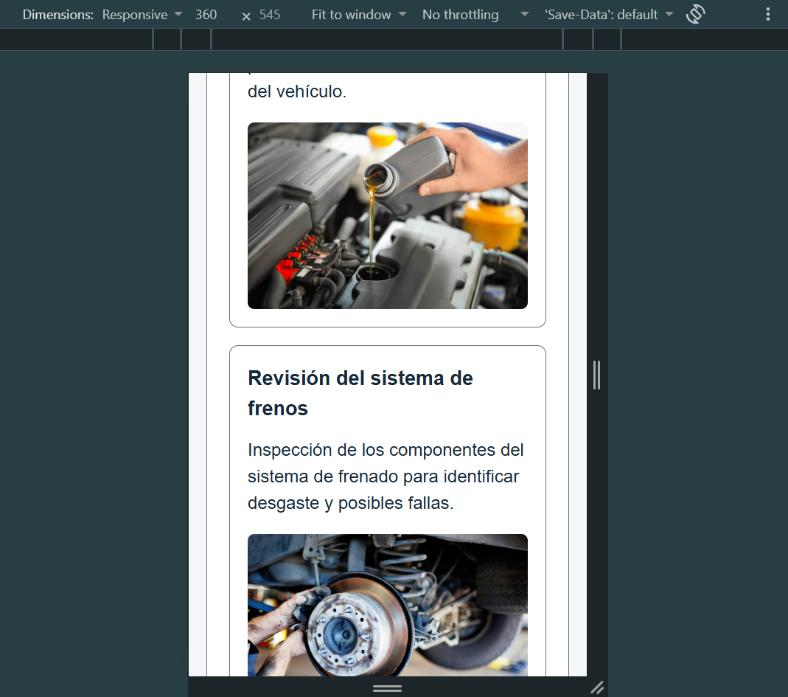
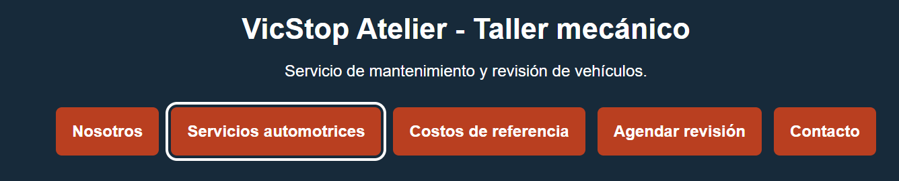
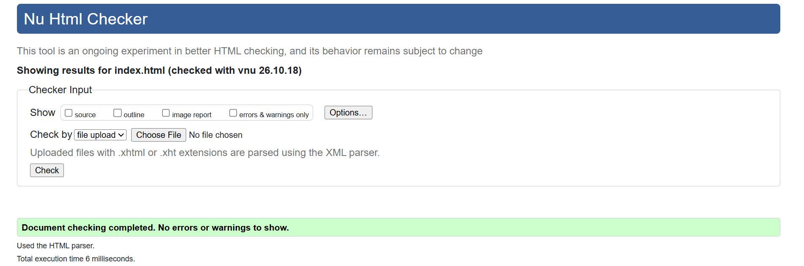
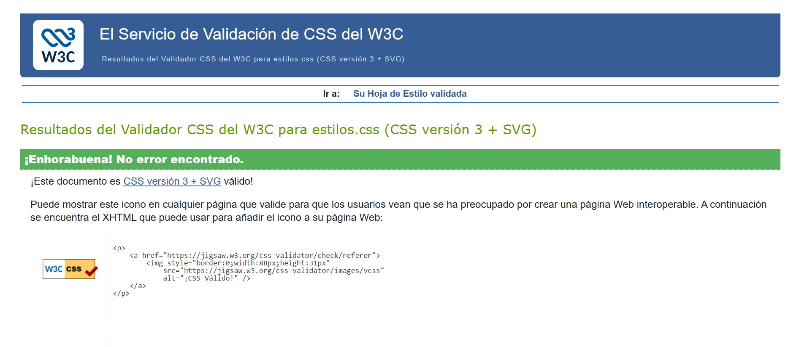
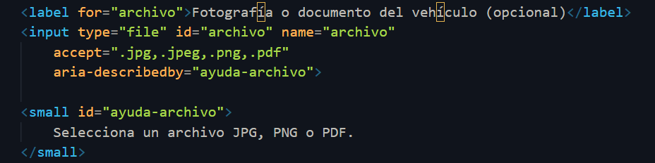
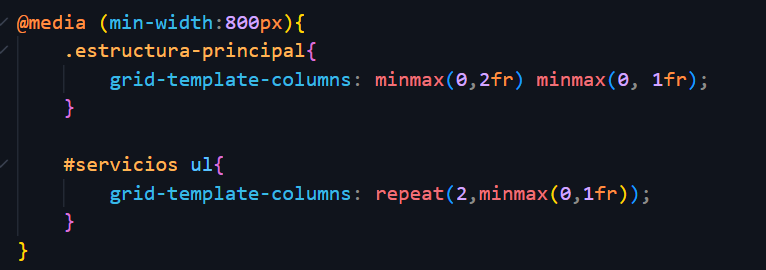
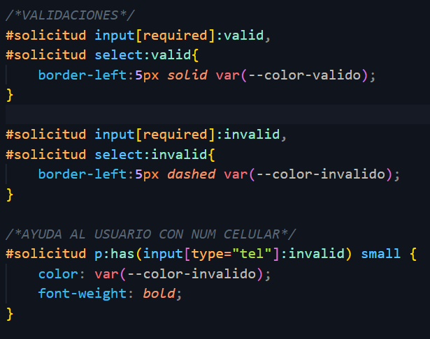

# AUDITORÍA

**Página revisada:** VicStop Atelier

**Compañera:** Victoria Andrade

**Repositorio:** https://github.com/VictoriaAndradeV/andrade-victoria-ESTANDARES-HTML

## Tabla de auditoría

| N.º | Requisito | Ubicación | Hallazgo | Norma que incumple | Evidencia | Severidad |
|---|---|---|---|---|---|---|
| 1 | Estructura HTML | `index.html` | La pagina tiene las etiquetas necesarias y los títulos estan bien organizados no encontre errores. | Ninguna | Esta parte puede verificarce en todo el codigo de index.html y si cumple todo| No  |
| 2 | Formulario | `index.html`, formulario | Los campos tienen sus etiquetas y validaciones ademas de que tambien probe el envio. | Ninguna | Evidencia dos | No  |
| 3 | Tabla | `index.html`, tabla de tarifas | La tabla tiene sus encabezados y los elementos solicitados. | Ninguna | Evidencia 3 | No  |
| 4 | Diseño adaptable | `css/estilos.css` | Probe la pagina a 360 px y ningun elemento se salio de la pantalla. | Ninguna | Evidencia 4 | No |
| 5 | Navegación con teclado | `index.html` y `css/estilos.css` | Pude recorrer los enlaces, botones y campos con Tab ademas de que tambien aparecieron los bordes de seleccion. | Ninguna | Evidencia 5 | No  |
| 6 | Validación HTML | `index.html` | El validador W3C mostro 0 errores y 0 advertencias. | Ninguna | Evidencia 6 | No  |
| 7 | Validación CSS | `css/estilos.css` | El validador W3C indico que el CSS es valido y no tiene errores. | Ninguna | Evidencia 7  | No  |
| 8 | Ficha personalizada con numero de lista 2 | `index.html` y `css/estilos.css` | Tiene el campo para subir archivos, el breakpoint de 800 px y los selectores solicitados. | Ninguna | Evidencia 8 | No |

## Evidencias

### Evidencia 2. Formulario

### Evidencia 3. Tabla

### Evidencia 4. Diseño adaptable

### Evidencia 5. Navegación con teclado

### Evidencia 6. Validación HTML

### Evidencia 7. Validación CSS

### Evidencia 8. Ficha personalizada

