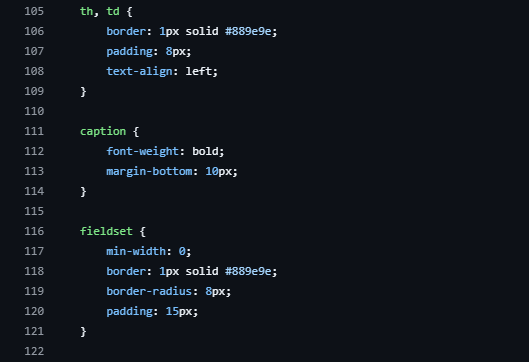

| N   | Requisito                | Ubicación                             | Hallazgo                                                                                                          | Norma que incumple | Evidencia                            | Severidad |
| --- | ------------------------ | ------------------------------------- | ----------------------------------------------------------------------------------------------------------------- | ------------------ | ------------------------------------ | --------- |
| 1   | Base 5: sintaxis CSS     | estilos.css , línea 7                 | Se usa el caracter '-' en lugar del selector universal '*' para la regla box-sizing, anulando el reset global    | W3C CSS            |  | Alta      |
| 2   | Base 5: accesibilidad    | index.html , línea 11                 | Falta el enlace directo de salto al contenido principal (Skip Link) para navegación accesible por teclado         | WCAG 2.2           |  | Alta      |
| 3   | Base 5: colores en var() | estilos.css , líneas 72, 85, 99 y 108 | Se definen colores fijos (#a7babb, #889e9e, #657e82) directamente en bordes e insumos sin hacer uso de var()     | W3C                |  | Baja      |