# RESPUESTA Y CORRECCIÓN

**Auditor:** Sebastian Calderon

## Tabla de respuesta

| N.º de hallazgo | Decision (acepta o refuta) | Justificación con la norma | Evidencia antes y después | Commit |
|---|---|---|---|---|
| 1 | Refutar | En la auditoria me pusieron que puse un guion en vez de un asterisco pero al revisar mi CSS se puede ver que sí está el `*` pero este selector es valido en CSS por eso no lo cambio. | Hallazgo 1 | No aplica |
| 2 | Refutar | Mi pagina permite navegar con Tab y Enter y tiene foco visible ademas uso `nav`, `main` y encabezados para organizar el contenido y en si la norma WCAG 2.4.1 no exige especificamente un Skip Link ya que existen otros mecanismos de navegacion accesible por lo que para mi su ausencia no es un error | Hallazgo 2 | No aplica |
| 3 | Aceptar | Revise y si encontre que los bordes tenian los colores escritos directamente y la actividad pide usar variables CSS voy a cambiarlos para que todos los colores esten mejor organizados. | Hallazgo 3 | Correcion de los coloress|

## Evidencias

### Hallazgo 1.

**Evidencia auditor**

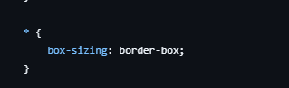

**Mi evidencia**

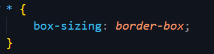

### Hallazgo 2.

**Evidencia auditor**

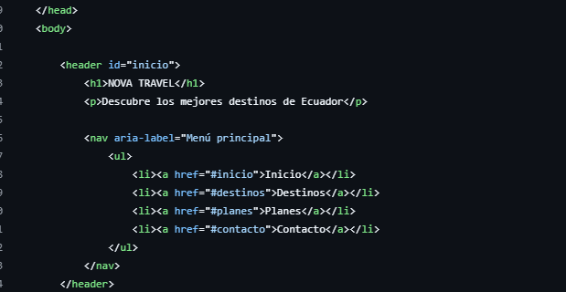

**Mi evidencia**

**Estructura HTML:**

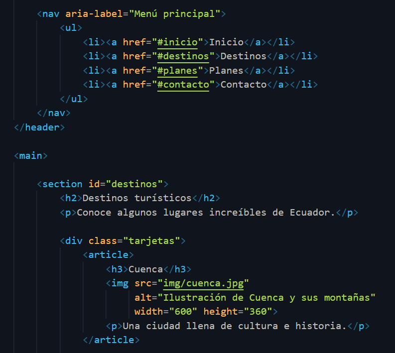

**Navegacion con teclado:**

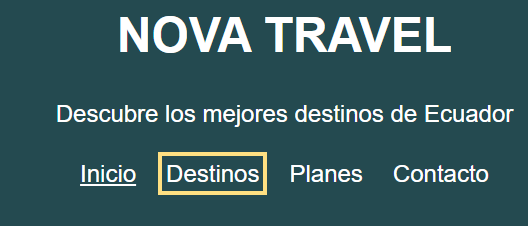

**Region de navegación:**

Se puede ver que su role esta en navegacion.

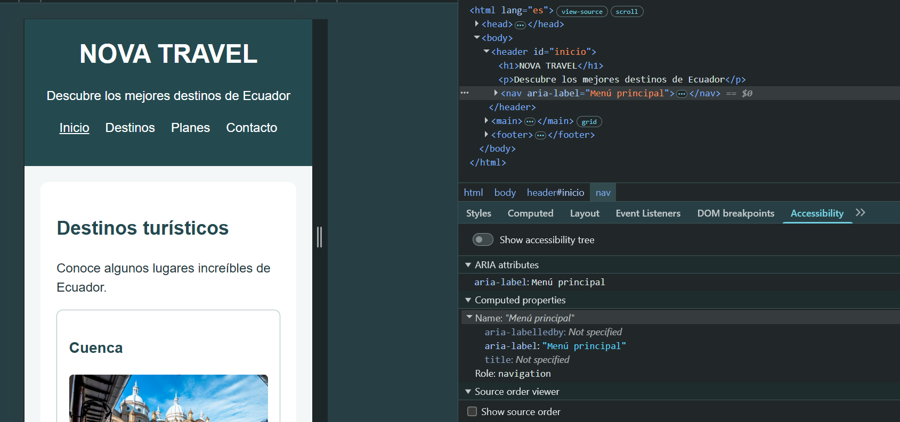

**Contenido principal:**

Se puede ver que su rol esta en main.

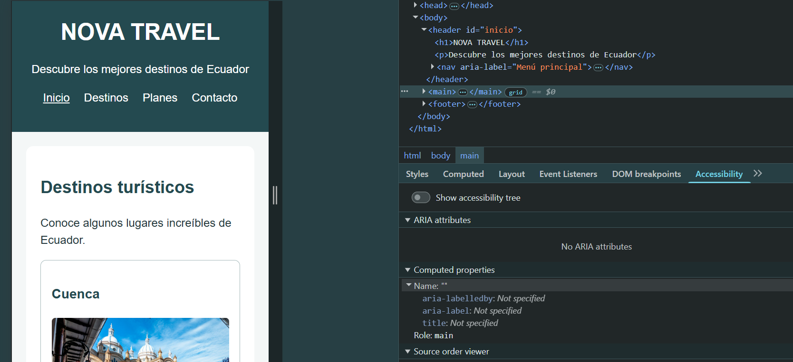

### Hallazgo 3.

**Antes:**

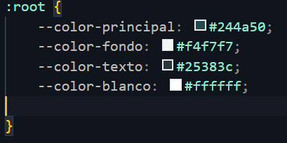

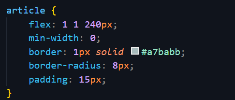

**Después:**

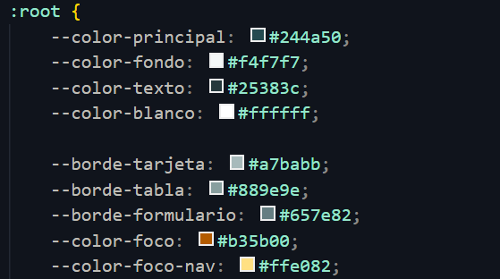

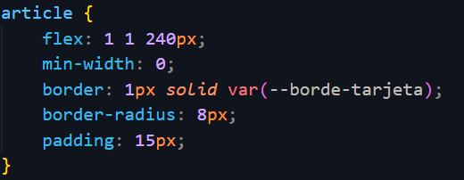

